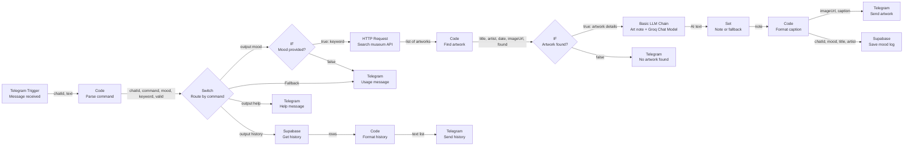
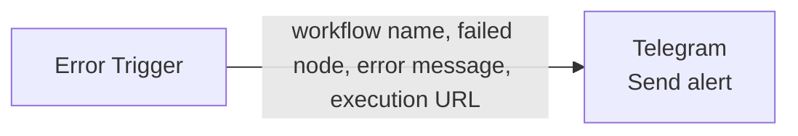

# Mood to Masterpiece

A Telegram bot built with n8n. You send it a mood, it answers with a real public-domain artwork from a museum and a short AI-written note that teaches you something about the work and the artist.

- **Bot:** [@art_and_mindset_bot](https://t.me/art_and_mindset_bot)
- **Author:** Apolline Seguin
- **Hosting:** n8n Cloud (not self-hosted)
- **Release:** `v1.0`

## The need

Many people find art history intimidating and museum websites are searched by title or artist, so they never start. This bot uses how you feel as the way in: **one message, one artwork, one small lesson.**

## What the bot does

| You send | You get |
|---|---|
| `/mood sad` | A public-domain artwork (photo, title, artist, date, museum link) and a ~70-word art note |
| `/history` | Your last five moods and artworks, as a text list |
| `/help` | The list of commands |
| `/mood` (no mood) or any other text | A usage message with an example |
| A mood the museum cannot match | A message asking you to try another mood |

## 3. Architecture

Every arrow is labelled with the data it carries.



Separate error workflow, linked in the main workflow settings:



### Why each building block

| Node | Type | Role |
|---|---|---|
| Message received | Telegram Trigger | Starts the workflow on every message to the bot |
| Parse command | Code | Splits the text into command and mood, maps the mood to an English keyword, flags an empty mood |
| Route by command | Switch | Four outputs: mood, history, help, Fallback. Every message gets an answer |
| Mood provided? | IF (`valid === true`) | Stops empty requests before any API call |
| Search museum API | HTTP Request | Cleveland Museum of Art Open Access API, public-domain works with images, no API key. Retry On Fail |
| Find artwork | Code | Keeps works with a usable image and picks one at random |
| Artwork found? | IF (`found === true`) | Handles a search with no result |
| Art note | Basic LLM Chain + Groq Chat Model (sub-node) | Writes the ~70-word note from a written prompt. Retry On Fail, continues on error |
| Note or fallback | Set | Uses the AI note, or a fallback sentence if the AI failed |
| Format caption | Code | Builds one flat object read by both Send artwork and Save mood log |
| Send artwork | Telegram, Send Photo | Replies in the same chat. Runs in parallel with the save |
| Save mood log | Supabase, Create a row | Persistence: one row per request |
| Get history / Format history / Send history | Supabase, Code, Telegram | Reads the last five rows of the chat and sends a readable list |
| Help message / Usage message / No artwork found | Telegram | Human-readable answers, no raw JSON |

`=== true` is used in both IF nodes so that a missing field becomes `false` instead of an error.

## Services and credentials

No secret is stored in this repository. The workflow JSON only contains credential **names**; you create the credentials yourself in n8n (**Credentials → Create credential**).

| Credential in n8n | Where to get it | Used by |
|---|---|---|
| Telegram API | Talk to [@BotFather](https://t.me/BotFather), `/newbot`, copy the token | Telegram Trigger and all Telegram nodes |
| Groq API | [console.groq.com](https://console.groq.com) → API Keys (free plan) | Groq Chat Model |
| Supabase API | Supabase project → Project Settings → API: Project URL and `service_role` key | Save mood log, Get history |

`.env.example` lists these names with empty values, as a checklist. n8n Cloud stores credentials in its own encrypted store, so no `.env` file is needed to run it.

## Setup, from clone to running

1. **Clone** the repository and open it:
   ```bash
   git clone https://github.com/<<YOUR-GITHUB-USERNAME>>/mood-to-masterpiece.git
   cd mood-to-masterpiece
   ```
2. **Create the database table.** In Supabase, open **SQL Editor → New query**, paste and run:
   ```sql
   -- adapt the columns to the ones used by the "Save mood log" node
   create table mood_log (
     id         bigint generated always as identity primary key,
     created_at timestamptz not null default now(),
     chat_id    bigint not null,
     mood       text,
     title      text,
     artist     text
   );
   ```
3. **Create the credentials** listed in section 4 (Telegram API, Groq API, Supabase API).
4. **Import the workflows** in n8n: **Workflows → ⋯ (top right) → Import from file**, then choose:
   - `workflows/mood-to-masterpiece.json`
   - `workflows/error-alert.json`
5. **Attach the credentials.** Open each Telegram, Groq and Supabase node and select your credential in the **Credential** field.
6. **Link the error workflow.** In the main workflow, **⋯ → Settings → Error workflow →** `Error alert`. In `Error alert`, set the **Chat ID** of the Telegram node to your own chat id.
7. **Publish** the main workflow (top right **Publish**). Do not click **Execute workflow** afterwards: Telegram allows one webhook at a time and a test run replaces the production one.

## How to test

Send these messages to the bot. No click in n8n is needed once the workflow is published.

| Test | Message | Expected result |
|---|---|---|
| Full round trip | `/mood sad` | A photo of an artwork with a caption and an art note, in the same chat |
| Persistence | `/history` | A list including the mood you just sent |
| Missing argument | `/mood` | Usage message with an example |
| Unknown command | `hello` | Usage message with an example |
| Help | `/help` | The list of commands |
| No result | a mood the museum cannot match | "No artwork found" message |
| Failure | In the museum node, break the URL, publish, send `/mood sad` | After the retries, the alert arrives on Telegram. Restore the URL and publish again |

Then open **Executions** in n8n: each run is listed, and you can open a run to see the data at every node.

## Robustness

- **Retry On Fail** on every call to an outside service (museum API, Groq, Supabase), with max tries and wait set, for short outages and rate limits.
- **Fallback sentence** when the AI answers nothing or fails (Art note continues on error, Note or fallback fills in).
- **Invalid input** (missing argument, unknown text) returns a usage message instead of failing.
- **Error workflow** (Error Trigger) sends a Telegram alert with the workflow name and the execution URL.
- **Parallel branches:** if the database save fails, the photo still arrives.


Screenshots

| What | Image |
|---|---|
| Workflow in n8n | |
| `/mood sad` answer in Telegram |  |
| Executions tab, runs in green |  | 
| `mood_log` table in Supabase ||

## What changed since the scoping document

- **AI provider:** Mistral → **Groq** (`openai/gpt-oss-20b`), because Mistral's free plan no longer gives API keys.
- **Museum:** Art Institute of Chicago → **Cleveland Museum of Art**, because the Chicago image server blocks automated requests, so Telegram could not fetch the pictures. The Cleveland API is public domain (CC0) and needs no key.
- **One workflow instead of a sub-workflow:** the museum search is used by a single command and the whole workflow fits on one screen, so a sub-workflow would add a second place to debug without any benefit.

## Known limits and next steps

- The workflow is hosted on n8n Cloud; there is no Docker setup.
- Sending the exact same message twice creates two rows (no idempotency key yet). A unique key on the Telegram update id would fix it.
- Next: more museums and a `/random` command. That would be the moment to extract the museum search into a sub-workflow.

## Repository content

```
mood-to-masterpiece/
├── README.md
├── .gitignore
├── .env.example
└── workflows/
    ├── mood-to-masterpiece.json
    └── error-alert.json
```

